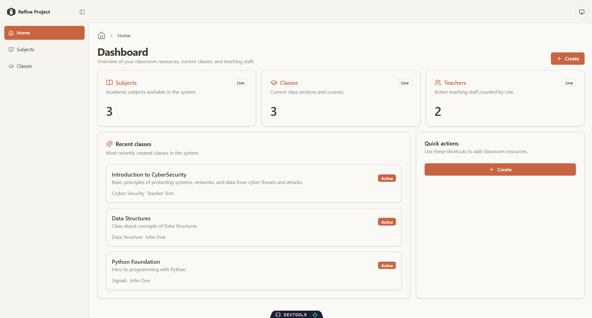
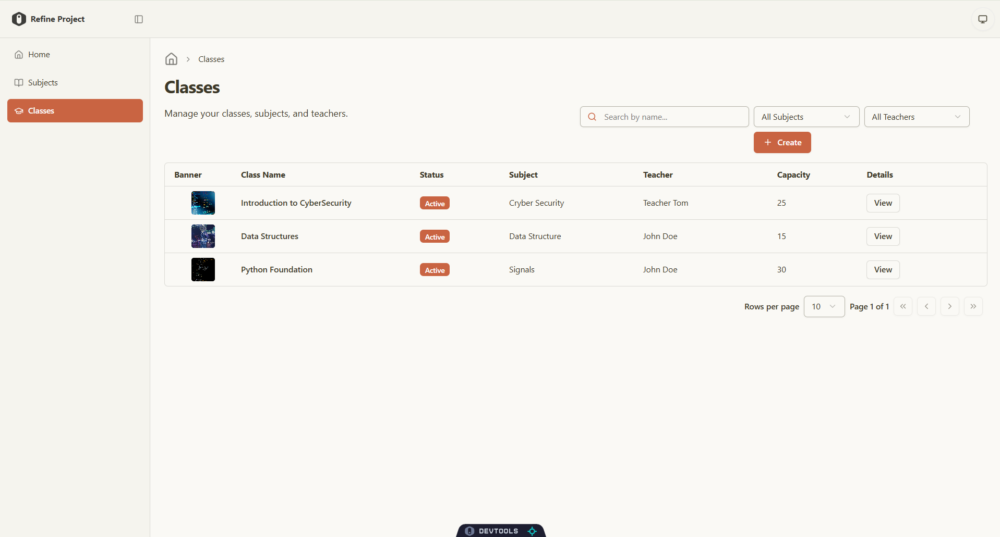
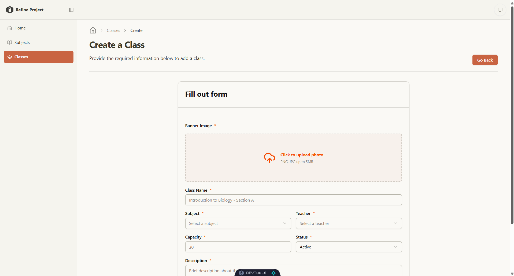
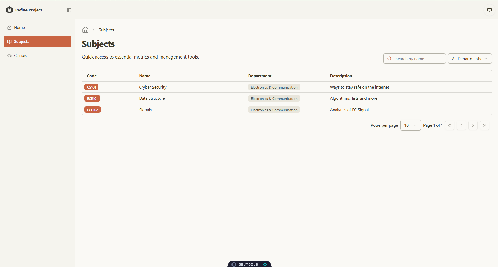
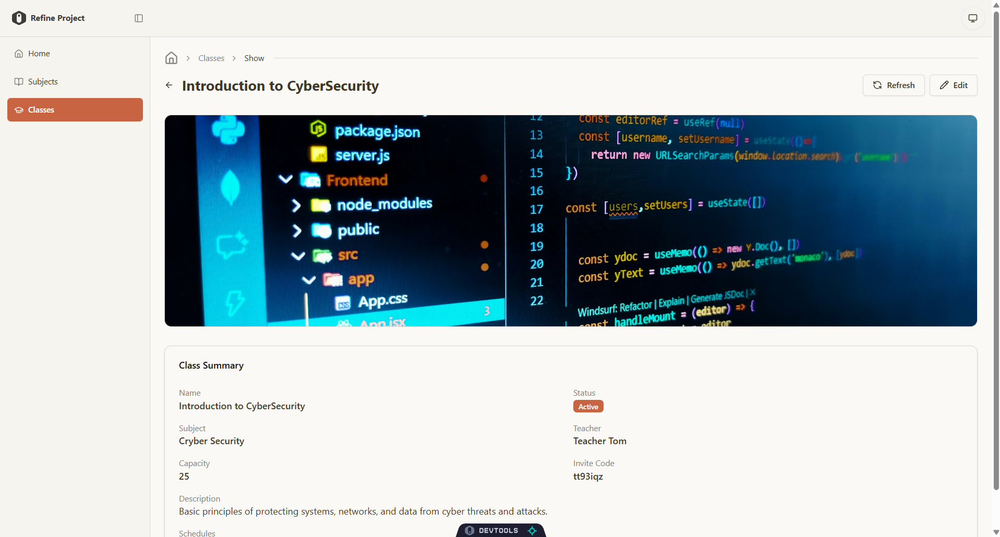

# Classroom Management System
A full-stack web application designed for managing school operations, courses, and schedules. Built with a modern TypeScript stack, featuring a responsive admin dashboard and a relational database backend.
## Overview
This project was built as a portfolio piece to demonstrate building a production-ready web application from database design to frontend UI. It provides an administrative interface for schools and universities to organize departments, manage subjects, assign teachers to classes, and set up weekly class schedules.
## Screenshots
### Dashboard

### Class Management

### Create Class & Schedules

### Subjects

### Class Details

## Key Features
- **Dashboard:** At-a-glance metrics showing total subjects, active classes, and teachers.
- **Class Management:** Create, view, and organize classes with subject details, assigned teachers, seat capacity, invite codes, and custom schedules.
- **Subjects & Departments:** Organize academic subjects under their respective departments.
- **Search & Filters:** Server-side search and filtering across classes, subjects, and users with pagination.
- **Banner Uploads:** Integrated Cloudinary upload widget for class banner images.
- **Command Menu & Theming:** Quick keyboard navigation (`Ctrl+K` / `Cmd+K`) and dark/light mode toggle.
- **Security:** Built-in rate limiting and bot protection using Arcjet.
## Tech Stack
- **Frontend:** React, TypeScript, Vite, Refine, Tailwind CSS, Radix UI
- **Backend:** Node.js, Express, TypeScript
- **Database:** PostgreSQL (Neon), Drizzle ORM
- **Auth & Security:** Better Auth, Arcjet
- **Media Storage:** Cloudinary
## How to Run Locally
### Prerequisites
- Node.js (v18+)
- PostgreSQL database (or Neon connection string)
- Cloudinary account for media uploads (optional)
### Setup
1. **Clone the repository:**
   ```bash
   git clone https://github.com/Jul10r/classroom.git
   cd classroom
   ```
2. **Backend:**
   ```bash
   cd classroom-backend
   npm install
   ```
   Add a `.env` file inside `classroom-backend/`:
   ```env
   DATABASE_URL=your_postgres_connection_string
   FRONTEND_URL=http://localhost:5173
   BETTER_AUTH_SECRET=your_auth_secret
   ```
   Run migrations and start the backend:
   ```bash
   npm run db:migrate
   npm run dev
   ```
3. **Frontend:**
   ```bash
   cd ../classroom-frontend
   npm install
   ```
   Add a `.env` file inside `classroom-frontend/`:
   ```env
   VITE_BACKEND_BASE_URL=http://localhost:8000/api/
   VITE_CLOUDINARY_CLOUD_NAME=your_cloud_name
   VITE_CLOUDINARY_UPLOAD_PRESET=your_preset
   VITE_CLOUDINARY_UPLOAD_URL=https://api.cloudinary.com/v1_1/your_cloud_name/image/upload
   ```
   Start the frontend:
   ```bash
   npm run dev
   ```
